  

Software house em Goiânia, atuando em todo o Brasil. A Bytecode projeta e constrói agentes, automações e produtos digitais com inteligência artificial para empresas, e desenvolve a [Dolt](https://dolt.com.br), plataforma de vendas, locação e gestão para imobiliárias brasileiras.

Tratamos inteligência artificial como parte do sistema, com a mesma exigência de teste, segurança e manutenção de qualquer outra peça. O que entregamos funciona em produção, não em demonstração.

## O que fazemos

| Frente | O que entrega |
| --- | --- |
| Agentes de atendimento com IA | Atendem no WhatsApp, no site e por e-mail, entendem o pedido e registram tudo no sistema da empresa |
| Automação de processos com IA | Leitura de documentos, extração de dados, classificação e geração de textos, com revisão humana onde importa |
| Produtos digitais sob medida | Sistemas web e aplicativos para Android e iPhone, do desenho à publicação |
| Plataformas SaaS multiempresa | Isolamento por empresa, planos, cobrança recorrente e conformidade com a LGPD |
| Integrações e dados | Pagamentos, assinatura eletrônica, mensageria, portais e bancos de dados |
| Evolução de sistemas existentes | Diagnóstico, segurança, desempenho e novas funcionalidades sem parar a operação |

Como trabalhamos, formas de contratação e contato em [www.bytecode.company](https://www.bytecode.company).

  

## Dolt

A Dolt junta o que a operação da imobiliária hoje espalha em planilha, conversa e sistema solto: imóvel, funil, WhatsApp, proposta, contrato e prestação de contas. A vitrine leva a marca da imobiliária. O contato do proprietário e do locador fica reservado a quem o cargo permite ver.

| Produto | Para quem | O que resolve |
| --- | --- | --- |
| [Dolt Imob](https://dolt.com.br) | Compra, venda e captação | Anunciar, negociar e vender imóveis, com funil, simulação e contrato |
| [Dolt Locação](https://dolt.com.br/?produto=aluguel) | Administração de aluguel | Alugar, cobrar, vistoriar e acompanhar o contrato até o repasse |
| Dolt Mobile | Equipe em campo | A operação da imobiliária no celular, com o mesmo backend da plataforma |
| [Site](https://dolt.com.br) | Quem avalia a plataforma | Apresentar a empresa, os planos, a documentação e o atendimento |

**Dolt Imob**, o CRM de vendas: funil de vendas em seis etapas e de captação em cinco, com prazo de resposta na ficha; WhatsApp oficial da Meta ligado à negociação; simulação de financiamento em cinco bancos, nas tabelas SAC e Price; anúncio no site da imobiliária, no ZAP, no VivaReal e na OLX; proposta que vira contrato para assinatura eletrônica e comissão calculada no fechamento. Comprador e proprietário acompanham a própria etapa por link, sem acessar o painel.

**Dolt Locação**, o CRM de administração de aluguel: pacote mensal calculado no cadastro; ficha que compara a renda com o pacote; garantia nas modalidades da Lei 8.245/91; laudo de vistoria de entrada e saída; cobrança por competência com repasse ao locador já descontado; reajuste por IGP-M, IPCA ou INPC; IRRF e DIMOB. Inquilino e locador acompanham o contrato por link.

**O que os dois compartilham:** cada imobiliária fica no próprio espaço; o imóvel só vai ao ar depois da aprovação; o interessado acha o imóvel no celular e fala com a equipe; o domínio próprio da vitrine entra quando o plano permite; pedido de titular de dados vai para um canal separado do suporte.

## Como a rotina anda

1. O captador cadastra o imóvel e a documentação. O gestor aprova antes da vitrine e dos portais.
2. O contato que chega do site ou do portal entra no funil, com WhatsApp, ficha ou simulação na mesma negociação.
3. A proposta aprovada vira contrato, laudo, cobrança recorrente ou comissão, sem planilha paralela.

## Empresa

**BYTECODE TECNOLOGIA LTDA**  
CNPJ 53.878.270/0001-66  
Rua J60, nº 20, Quadra 137, Lote 29, Setor Jaó  
Goiânia, GO, Brasil, CEP 74674-260  
Segunda a sexta, das 08h00 às 18h30  
Foro da Comarca de Goiânia, GO

## Contato

- Projetos e serviços: [www.bytecode.company](https://www.bytecode.company)
- Dolt: [dolt.com.br](https://dolt.com.br) e [documentação](https://dolt.com.br/documentacao)
- Suporte Dolt: [suporte@dolt.com.br](mailto:suporte@dolt.com.br)
- Dados pessoais: [privacidade@dolt.com.br](mailto:privacidade@dolt.com.br)
- WhatsApp: [(62) 99162-7496](https://wa.me/5562991627496)
